# Architecture and data flow

```mermaid
flowchart LR
    User[Research notebooks or installed Python CLI] --> API[Typed Python API]
    API --> FFI[PyO3 shared library: ofi_pipeline._native]
    FFI --> Core[Pure Rust core]
    Core --> Read[Explicit Lev-v1 streaming adapters]
    Read --> Merge[Original-ID producer]
    Merge --> Workers[Bounded symbol/session workers]
    Workers --> OFI[Gap-aware rank OFI and independent signing]
    OFI --> Grid[Right-closed intervals and original boundaries]
    Grid --> Temp[Private partition Parquet]
    Temp --> Publish[Ordered assembly and atomic directory publication]
    Publish --> Results[Features, all-bucket quality, provenance and QC]
```

Rust owns production I/O, conversion/validation, event ordering, OFI, signing,
aggregation, hashes and Parquet/JSON writing. Python owns configuration, path
normalization, exception categories, typed reports and CLI arguments. PyO3
receives owned strings, then runs the coarse file-set operation inside
`Python::detach`. Workers access no Python objects, callbacks or interpreter state.
There is no Python fallback, pandas computation or per-event FFI call.

The core crate is independently testable. The binding crate is a cdylib and
contains only serialization/config/error glue. An optional standalone Rust CLI
was omitted: the installed Python CLI already exposes the same core without
adding a second configuration parser. Research model estimation is excluded.

Native readers decode bounded Arrow batches or gzip CSV records. A producer
validates increasing original IDs and nondecreasing UTC ns, preserves ties,
and merges quality/events/trades by ID. Quality covers every original row,
including rejected states; accepted-only inputs cannot prove boundaries. No
sorting, deduplication, timestamp join or percentile recalibration occurs.

Each worker owns one symbol/session and processes its chunks in sequence. Queue
capacity is one; active workers are bounded by `threads`. Pending workers close
and join before cleanup. The last valid predecessor is cleared at rejected gaps;
segment initialization is unknown. Original boundary state becomes invalid when
a newer rejected original appears. One open bucket and bounded output buffers
hold state; no event-count-sized collector exists. RAM depends on reader pages,
chunk size, worker count and explicitly capped per-partition metadata
(`max_partitions`). Parquet footer metadata also depends on the input file layout.
The Lev-v1 rejection vocabulary bounds per-partition reason maps. No Quote Test matching
queue grows with input length: one original pre-book suffices for paired LOBSTER.

Temporary disk contains partition output; final assembly reads it once in key
order. Quote Test ZIPs additionally spool two payloads once to private files, then
stream them by row correspondence. Raw sentinel/invalid books yield no valid
pre-quote. Inside-spread trades stay unknown with counts/volume. The known-
direction mode uses independently cleaned type-4/type-5 trades and `-direction`.
Raw ZIP spool size depends on archive payload, explicitly separate from RAM.

Integer prices are USD/10,000, with checked conversions and twice-mid arithmetic
that preserves half ticks. Source local-ns and UTC timestamps must agree in
America/New_York; delivered rounding flags/text are validated and summarized.
A separate hash pass provides provenance. Inputs must remain unchanged during a
run; do not concurrently mutate them. The manifest distinguishes deterministic
algorithm/schema/source metadata from variable QC runtime statistics.

Atomic directory rename publishes a completed dataset. Explicit overwrite
protects input collisions and other user files, moves owned results aside, and
restores them on publication failure where possible. This is a filesystem batch
operation, with a short path-absence window during overwrite, not a transaction
against unrelated external directory mutations or power failure.

The input boundary intentionally covers the verified Lev-v1 schema, not arbitrary
TAQ/NBBO fields. New adapters can normalize different physical schemas into the
same domain; unavailable depth and insufficient original history must remain
explicit errors. OFI and price change are contemporaneous; no forecasting,
trading profitability or research-model claims are part of this library.
