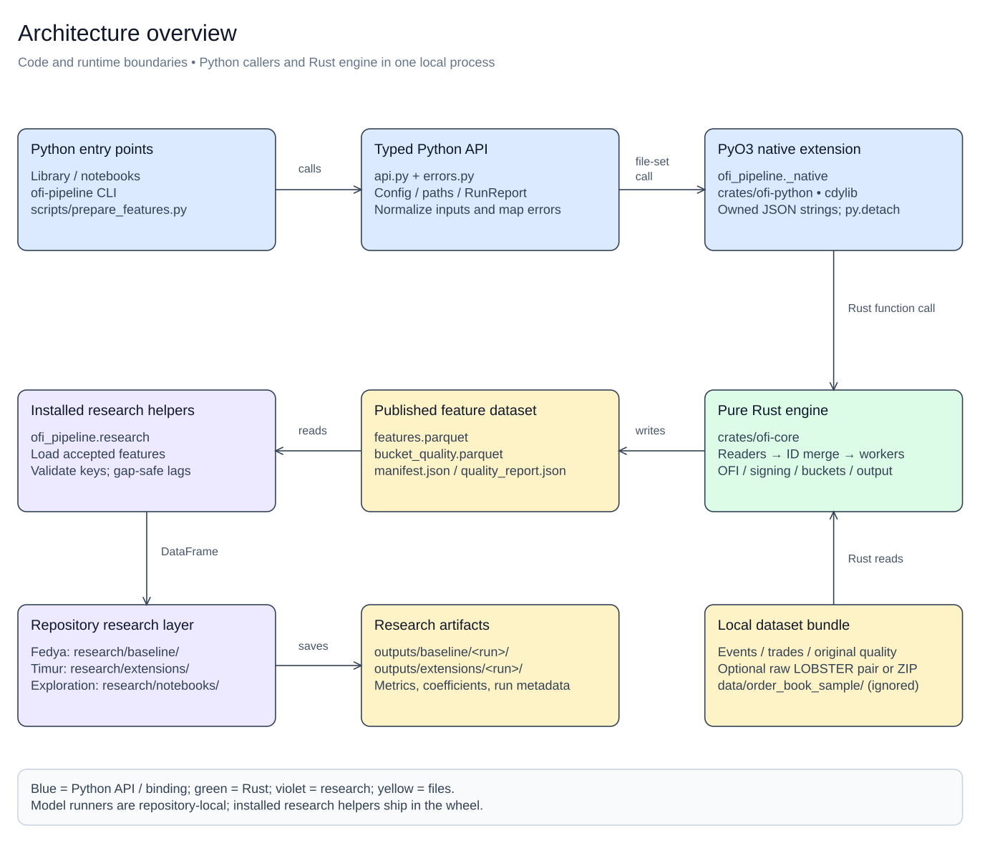
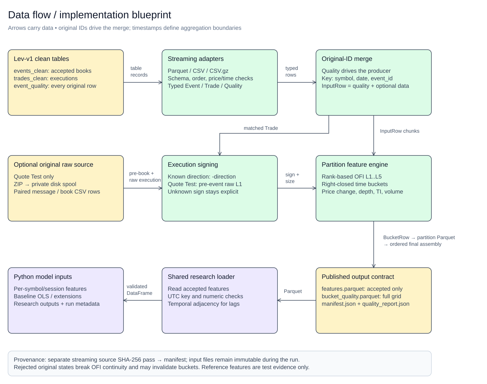
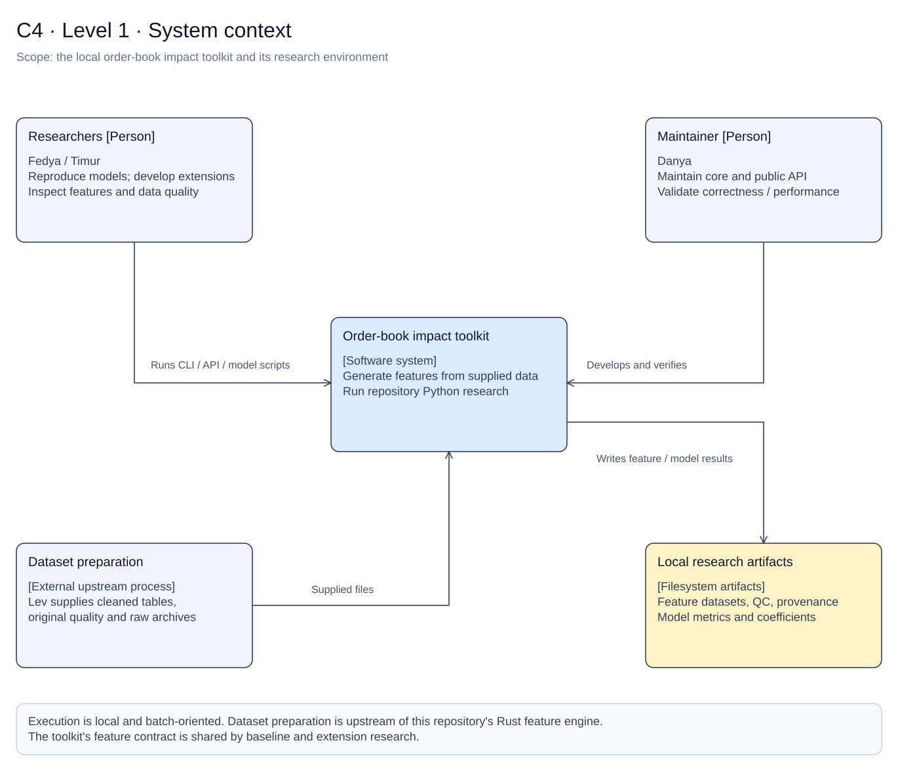
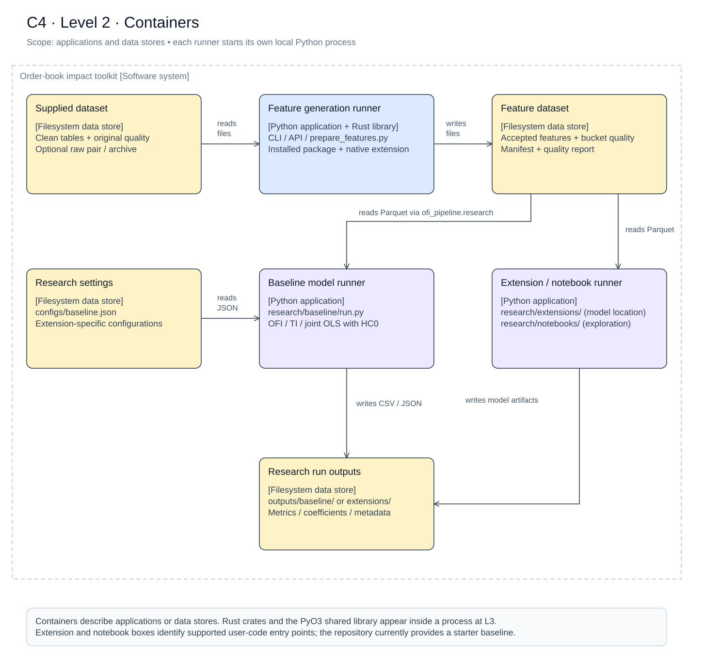
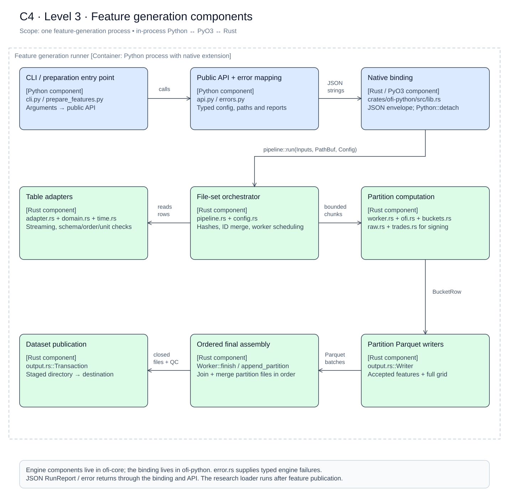
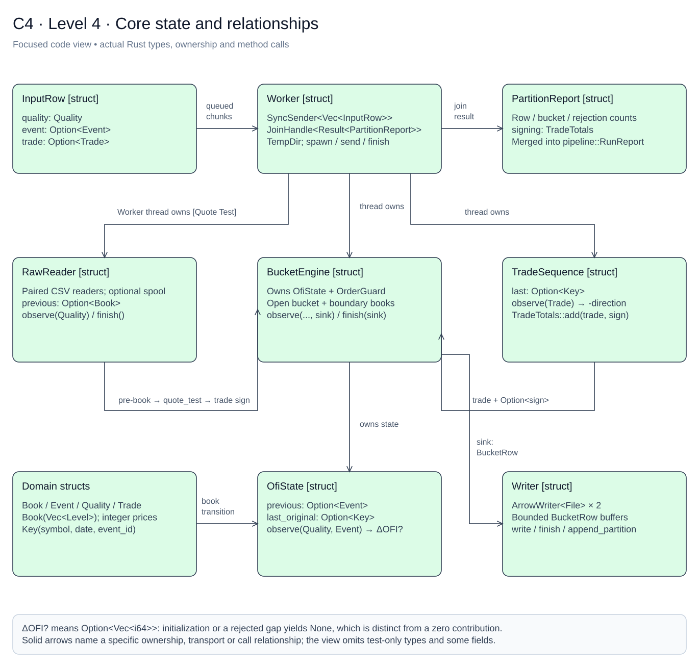

# Implementation diagram gallery

These diagrams describe the implemented toolkit, reviewed against engine commit
`41962ab` on 2026-10-14. They document existing code and extension points;
they are not a proposal for a different architecture.

Start with the architecture overview and data flow. Use C4 to zoom from the
system context into the local applications, components and core types.

Each diagram has an **SVG preview** that renders in GitHub and an editable
**Excalidraw scene**. Click a preview for full-size viewing. To edit, drag its
`.excalidraw` file into [Excalidraw](https://excalidraw.com/) or open it with an
Excalidraw-capable Obsidian/VS Code plugin. All diagram labels are in English.

## Index

| View | Preview | Editable scene | Elements |
| --- | --- | --- | ---: |
| Architecture overview | [SVG](01-architecture.svg) | [Excalidraw](01-architecture.excalidraw) | 47 |
| Data flow / implementation blueprint | [SVG](02-data-flow.svg) | [Excalidraw](02-data-flow.excalidraw) | 49 |
| C4 · Level 1 · System context | [SVG](03-c4-context.svg) | [Excalidraw](03-c4-context.excalidraw) | 27 |
| C4 · Level 2 · Containers | [SVG](04-c4-containers.svg) | [Excalidraw](04-c4-containers.excalidraw) | 41 |
| C4 · Level 3 · Feature generation components | [SVG](05-c4-components.svg) | [Excalidraw](05-c4-components.excalidraw) | 49 |
| C4 · Level 4 · Core state and relationships | [SVG](06-c4-code.svg) | [Excalidraw](06-c4-code.excalidraw) | 51 |

## Notation and scope

- Blue: Python interface and the native binding; green: Rust engine; violet:
  research code; yellow: local files; grey: people or upstream context.
- C4 L1 shows people and system context. L2 shows applications and file stores.
  L3 decomposes one feature-generation process. L4 is a focused Rust type and
  state relationship view, with representative fields rather than exhaustive UML.
- C4 containers follow the [application/data-store definition](https://c4model.com/diagrams/container).
  The [component view](https://c4model.com/diagrams/component) stays inside one
  application. The PyO3 shared library and Rust crates execute within the calling
  Python process; crate boxes describe code organization.
- Sequence messages run downward; dashed horizontal arrows are returns. Other
  arrows carry data or name their call/ownership relationship. Dashed outlines
  identify the scope being expanded.
- `research/extensions/` and `research/notebooks/` are supported places for team
  code. The runnable starter model is `research/baseline/run.py`. Its OLS results
  are in-sample; the diagrams do not assert forecasting or trading profitability.

## Architecture overview

High-level code ownership, runtime boundary and researcher extension points.

[Full-size SVG](01-architecture.svg) · [Editable scene](01-architecture.excalidraw)



Code anchors: [python/ofi_pipeline/api.py](../../python/ofi_pipeline/api.py), [python/ofi_pipeline/research.py](../../python/ofi_pipeline/research.py), [crates/ofi-python/src/lib.rs](../../crates/ofi-python/src/lib.rs), [crates/ofi-core/src/pipeline.rs](../../crates/ofi-core/src/pipeline.rs), [research/baseline/run.py](../../research/baseline/run.py).

## Data flow / implementation blueprint

Input records, original-row evidence, optional raw quotes, Rust features and Python model data.

[Full-size SVG](02-data-flow.svg) · [Editable scene](02-data-flow.excalidraw)



Code anchors: [crates/ofi-core/src/adapter.rs](../../crates/ofi-core/src/adapter.rs), [crates/ofi-core/src/pipeline.rs](../../crates/ofi-core/src/pipeline.rs), [crates/ofi-core/src/worker.rs](../../crates/ofi-core/src/worker.rs), [crates/ofi-core/src/buckets.rs](../../crates/ofi-core/src/buckets.rs), [crates/ofi-core/src/output.rs](../../crates/ofi-core/src/output.rs), [python/ofi_pipeline/research.py](../../python/ofi_pipeline/research.py).

## C4 · Level 1 · System context

People, software-system scope, upstream dataset preparation and local results.

[Full-size SVG](03-c4-context.svg) · [Editable scene](03-c4-context.excalidraw)



Code anchors: [README.md](../../README.md), [docs/DATASET_CONTRACT.md](../../docs/DATASET_CONTRACT.md), [python/ofi_pipeline/cli.py](../../python/ofi_pipeline/cli.py), [research/baseline/run.py](../../research/baseline/run.py).

## C4 · Level 2 · Containers

Feature generation, research runners and filesystem stores; native code remains inside the Python process.

[Full-size SVG](04-c4-containers.svg) · [Editable scene](04-c4-containers.excalidraw)



Code anchors: [python/ofi_pipeline/cli.py](../../python/ofi_pipeline/cli.py), [scripts/prepare_features.py](../../scripts/prepare_features.py), [research/baseline/run.py](../../research/baseline/run.py), [research/extensions/README.md](../../research/extensions/README.md), [configs/baseline.json](../../configs/baseline.json).

## C4 · Level 3 · Feature generation components

Components inside the feature-generation application, including production I/O and publication.

[Full-size SVG](05-c4-components.svg) · [Editable scene](05-c4-components.excalidraw)



Code anchors: [python/ofi_pipeline/api.py](../../python/ofi_pipeline/api.py), [crates/ofi-python/src/lib.rs](../../crates/ofi-python/src/lib.rs), [crates/ofi-core/src/pipeline.rs](../../crates/ofi-core/src/pipeline.rs), [crates/ofi-core/src/worker.rs](../../crates/ofi-core/src/worker.rs), [crates/ofi-core/src/output.rs](../../crates/ofi-core/src/output.rs).

## C4 · Level 4 · Core state and relationships

Code-level state owned by partition workers and BucketEngine, with typed inputs, sink and output report.

[Full-size SVG](06-c4-code.svg) · [Editable scene](06-c4-code.excalidraw)



Code anchors: [crates/ofi-core/src/worker.rs](../../crates/ofi-core/src/worker.rs), [crates/ofi-core/src/buckets.rs](../../crates/ofi-core/src/buckets.rs), [crates/ofi-core/src/ofi.rs](../../crates/ofi-core/src/ofi.rs), [crates/ofi-core/src/domain.rs](../../crates/ofi-core/src/domain.rs), [crates/ofi-core/src/trades.rs](../../crates/ofi-core/src/trades.rs), [crates/ofi-core/src/raw.rs](../../crates/ofi-core/src/raw.rs).

## Keep the gallery current

Edit the `.excalidraw` sources when responsibilities, interfaces or semantics
change; review the code anchors and descriptions at the same time. Regenerate
and check the previews from the repository root:

```sh
python3 docs/diagrams/render.py
python3 docs/diagrams/render.py --check
```

On Windows use `py` instead of `python3`. The renderer uses the Python standard
library and supports this gallery's unrotated rectangles, ellipses, lines,
arrows and text. It preserves explicit line breaks and uses a system sans-serif
font for portable SVG; editable scenes use Excalifont. It is a preview renderer,
not Excalidraw's full hand-drawn exporter. For added element types or rotated
shapes, export SVG with Excalidraw and update the preview workflow accordingly.

Before committing, inspect the previews for clipping and crossing labels,
verify source links, and run the check command. No dataset, compiled library or
research result is embedded in these diagrams.

