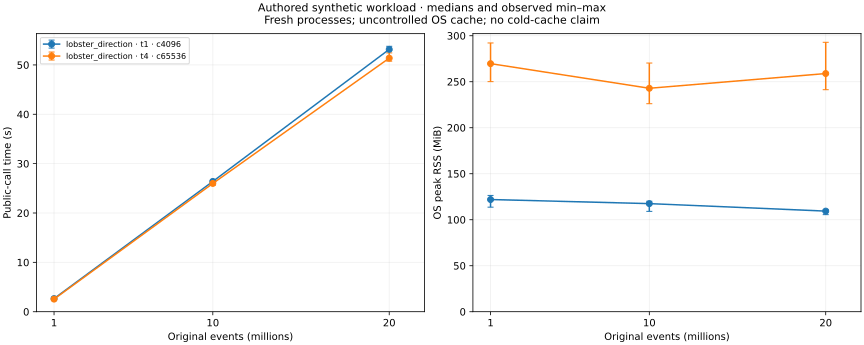
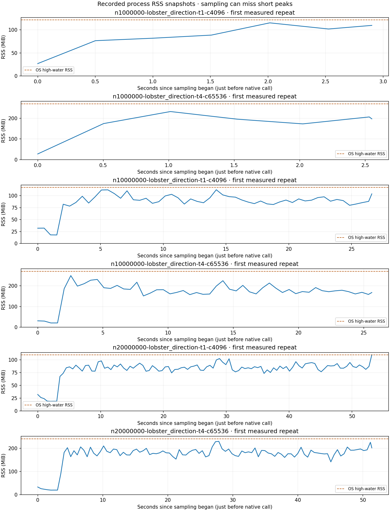

# High-load baseline · 1M / 10M / 20M original events

Measured on 2026-10-14 using the release native extension and benchmark source
commit `ecdaa97`. This is the baseline for a later Rust
optimization task; no production Rust code or public interfaces changed here.

See the [benchmark protocol](../../benchmarks/HIGH_LOAD.md),
[runner](../../benchmarks/high_load.py), [bounded generator](../../benchmarks/high_load_fixture.py)
and [machine-readable comparison reference](results.json).

## Workload and measurement scope

Four independent synthetic symbols, five varying book ranks, type-4/type-5
executions of both signs, and deliberate supplied-quality gaps. Each symbol
covers a full 09:30–16:00 New York session. Sizes count original quality rows;
accepted event and execution tables are separate. These are authored stress-test
states, not real market observations or repeated copies of a delivered day.

The suite ran **24 fresh processes: 6 warmups and 18 measured runs**, serially.
Each case has one warmup and three measured repetitions. Timing includes the
complete public Python/PyO3-backed pipeline call, source hashing, all Rust
computation, intermediate output assembly and publication. Release build,
input generation, process startup, verification and plots are excluded.

`t1-c4096` uses one worker and 4,096-row chunks. `t4-c65536` allows up to four
workers and 65,536-row chunks. Both parameters change, so this is an operating
point comparison, not an isolated test of adding threads. All cases use the
known LOBSTER-direction signing mode, five levels and 10-second buckets.

Platform: `macOS-26.5.1-arm64-arm-64bit`; Python `3.12.0`;
10 logical CPUs. The loaded extension SHA-256, engine/harness source hashes,
input identities, settings and host identity hash are retained in results.json.
OS cache is uncontrolled and leans warm after generation/checks and warmups.

## Recorded results

| Original events | Configuration | Median s (min–max; MAD) | Rows/s | OS peak MiB median (min–max) |
| ---: | --- | --- | ---: | --- |
| 1M | t1 / c4096 | 2.656 (2.617–2.901; 0.039) | 376,471 | 121.92 (113.64–126.36) |
| 1M | t4 / c65536 | 2.551 (2.538–2.551; 0.000) | 392,015 | 269.63 (250.09–292.13) |
| 10M | t1 / c4096 | 26.396 (26.260–26.615; 0.136) | 378,845 | 117.48 (109.09–120.05) |
| 10M | t4 / c65536 | 25.988 (25.626–26.056; 0.067) | 384,787 | 242.86 (226.06–270.27) |
| 20M | t1 / c4096 | 53.153 (52.907–53.774; 0.246) | 376,275 | 109.34 (105.53–110.66) |
| 20M | t4 / c65536 | 51.378 (50.766–52.438; 0.613) | 389,268 | 258.88 (241.28–292.86) |



Observed throughput stays around 376k–392k original events/s. In this series,
time scales approximately with row count, while peak process RSS does not grow
proportionally from 1M to 20M. The maximum measured process peak was 292.86 MiB. This is evidence for these workloads/settings, not a universal memory bound.
Larger chunks have substantially higher observed RSS with modest time differences;
thread effects cannot be separated from chunk effects using just these two cases.

## Input footprint and correctness

| Original rows | Accepted event rows | Execution rows | Compressed input MiB |
| ---: | ---: | ---: | ---: |
| 1,000,000 | 999,992 | 40,000 | 52.37 |
| 10,000,000 | 9,999,904 | 400,000 | 515.46 |
| 20,000,000 | 19,999,804 | 800,000 | 1025.99 |

All 24 runs passed partition/original-event/trade/sign/volume conservation,
complete-grid, ordered-key, accepted-feature/schema and input-manifest checks.
Decoded feature and full-quality row fingerprints matched across repeats and
chunk/thread cases at each size. Source and loaded binary hashes were unchanged
throughout the suite, with a clean tracked tree at both source snapshots.

The 20M fixture has **20,000,000 original rows, 19,999,804 accepted event rows
and 800,000 execution rows**. Source quality deliberately rejects 196 original
states; they remain in evidence and reset OFI continuity.

Before this large series, 10 focused benchmark checks and the complete
Python/native/research/real-data/benchmark selection passed: **106 tests, no skips**.
This includes real-data reference verification of all five bucket widths.
Hosted CI was configured for small benchmark checks but was not run from this task.

## RSS snapshots and retained evidence



The traces show the first measured repeat per case, selected consistently rather
than choosing favorable runs. All repeats are represented in the table above.
Current RSS is sampled every 0.5 seconds by a small self-process thread while
Rust detaches from Python; its instrumentation cost is included consistently.
The dashed line is that process's OS high-water peak. Sampling can miss spikes,
and OS RSS accounting can differ by platform. The trace clock begins just before
the pipeline call; the low-memory opening phase includes source hashing.

Full local evidence is in the ignored
`benchmarks/results/high-load/baseline-20261014/` directory: build/generation logs,
per-run commands, phase/measurement/verification JSON, RSS JSONL, CSV/MD summaries
and plot exports. Inputs remain under ignored `data/high_load/`; feature outputs
remain under ignored `outputs/features/high-load/`. Those large artifacts are
not committed. This document, compact comparison reference and plotted snapshots
are committed for review.

## Reproduce or compare an optimization

Run from the repository root; use a new result root. The compact reference can
be used directly, without putting the full local results into Git:

```sh
.venv/bin/python -m benchmarks.high_load \
  --root benchmarks/results/high-load/candidate-20261014 \
  --reuse-fixtures --offline \
  --compare-to docs/high_load/results.json
.venv/bin/python -m benchmarks.high_load_plot \
  benchmarks/results/high-load/candidate-20261014
```

If inputs are missing in another checkout, omit `--reuse-fixtures` to regenerate
with the pinned environment; comparison still requires the same source SHA-256
values and host/runtime. For a new machine or changed harness, first record a
fresh baseline there. Do not compare an unverified/debug artifact against this
release build or change workloads to improve a result.

Optional many-session, single-session and Quote Test scenarios are implemented
in the protocol. They were not measured at 10M/20M in this baseline. Quote Test
correctness was exercised with small authored raw pairs; the default large run
contains no raw archives and makes no high-load Quote Test/ZIP performance claim.
